<!-- project-status:start -->
## 项目状态与入口

- **维护状态**：主线维护 · 独立专业工具。
- **项目入口**：运行、构建与计算模型说明见下方文档。
- **项目导航**：[全部项目与维护安排](https://github.com/halunhaku)。

<!-- project-status:end -->

<p align="center">
  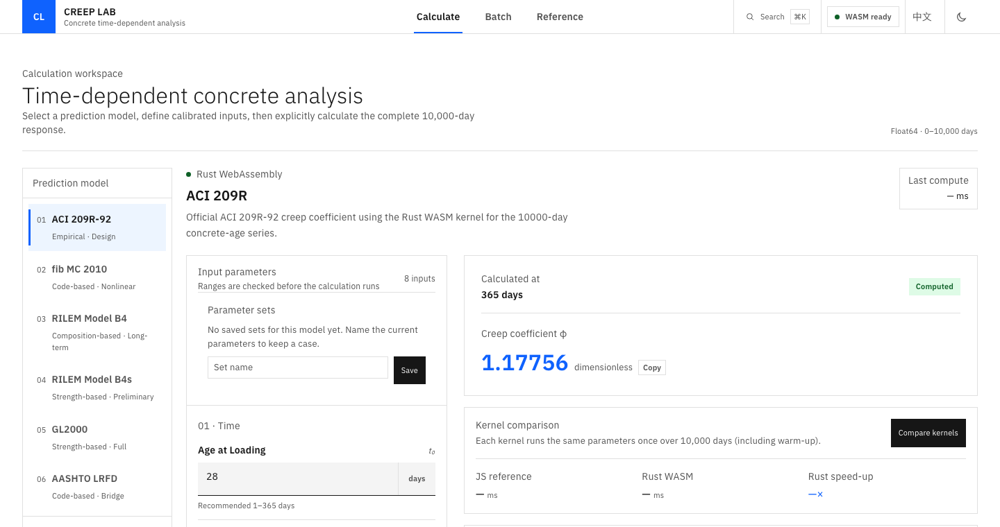
</p>

<h1 align="center">CREEP_LAB</h1>

<p align="center">
  A quiet concrete creep and shrinkage calculation workspace with JavaScript and Rust WebAssembly engines.
</p>

<p align="center">
  <code>React 19</code>
  <code>Vite 8</code>
  <code>Rust WASM</code>
  <code>Recharts</code>
  <code>Tailwind CSS</code>
  <code>MIT</code>
</p>

---

## Overview

CREEP_LAB is a professional concrete creep and shrinkage calculation platform. It integrates ACI 209R-92, fib Model Code 2010, RILEM B4, RILEM B4s, GL2000, and AASHTO LRFD behind a Scientific Workbench interface: precise grouped inputs, explicit calculation state, engineering-blue emphasis, decomposition readouts, model-aware charts, and standards-oriented reference pages.

The app is designed for local engineering exploration: tune model parameters, calculate long-term curves, import batch datasets, compare outputs, and read model documentation without leaving the workspace.

$$
\phi(t,t_0),\quad J(t,t'),\quad \varepsilon_{sh}(t)
$$

---

## Features

| Area | What it does |
| --- | --- |
| Calculation workspace | Select a model and engine, edit calibrated parameters, explicitly calculate, and inspect a target age within the 10,000-day series. |
| Batch pipeline | Upload CSV / XLSX cases, validate the schema and rows, inspect the result matrix, and export calculated outputs. |
| Result visualizer | Separate compliance and shrinkage curves, inspect decomposed values, switch linear/log time, and export chart data. |
| Reference library | Read implementation scope, calibrated ranges, equations, source mapping, limitations, and official references. |
| Dual engine | Use pure JavaScript reference kernels or Rust WebAssembly kernels, with a parity suite and an in-app timing comparison between them. The batch pipeline computes with the reference kernels for all six models — the Rust kernel exposes batch entry points for ACI 209 and MC 2010 only, so using it there would compute different models with different kernels. |
| Command palette | `⌘K` / `Ctrl+K`, or the header's Search button, reaches every destination from anywhere: workspaces, models, kernels, saved parameter sets, the reference library's sections, and the theme. |
| Keyboard and accessibility | In the calculation workspace, `⌘Enter` / `Ctrl+Enter` runs the calculation or focuses the first invalid parameter. Invalid inputs are associated with their error descriptions, and chart range handles expose minimum, maximum, and current values in data units to assistive technology. |
| Shareable state | The workspace, model and kernel live in the URL (`?mode=docs&model=b4&kernel=js`), so a view can be linked to, Back and Forward move between workspaces, and a refresh keeps the edited parameters. |

### Deep links

```
/?mode=single|batch|docs   which workspace
/?model=aci209|mc2010|b4|b4s|gl2000|aashto   which model (calculation and reference library)
/?kernel=rust|js           which engine the calculation workspace uses
```

Defaults are omitted, so a plain visit has a clean URL. The batch dataset is
deliberately not in the URL — it is a file, not a link — but it does survive
switching workspaces. Edited parameters are persisted locally and are kept out
of the URL; a case can be kept under a name from the parameter panel (or the
command palette), and loading one marks the results on screen as out of date
rather than presenting a stale number as current.

---

## Interface Preview

### Wide Workspace

| Single analysis | Batch matrix |
| --- | --- |
| 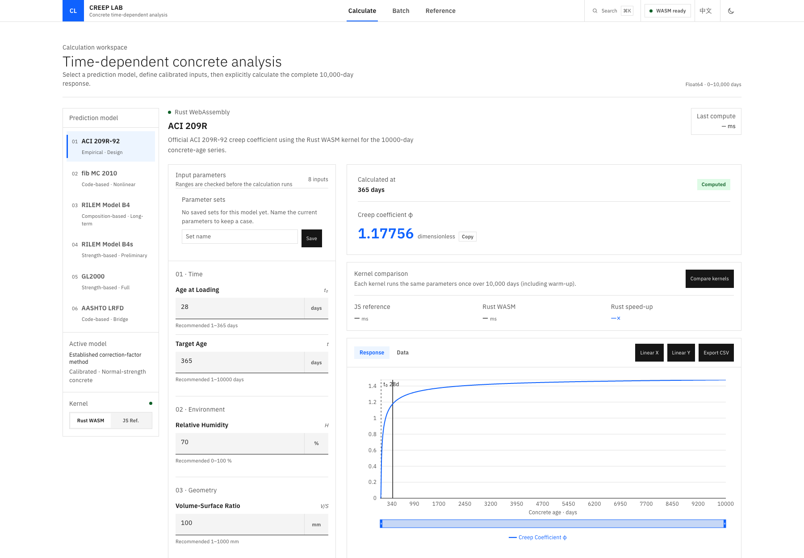 | 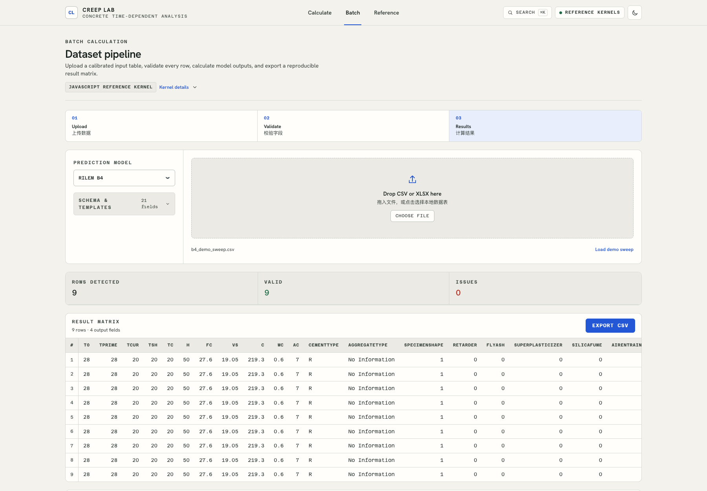 |

| Model docs |
| --- |
| 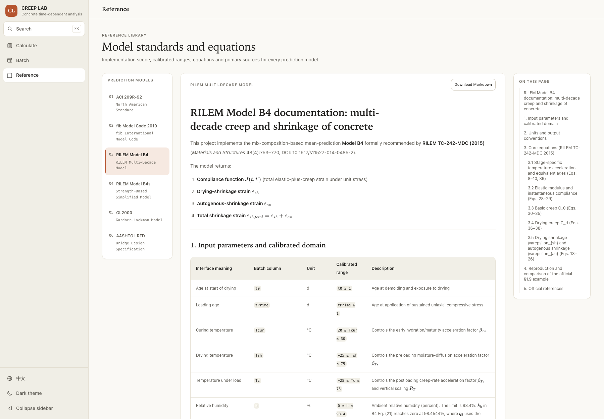 |

### Tall / Narrow Views

| Single analysis | Batch matrix | Model docs |
| --- | --- | --- |
| 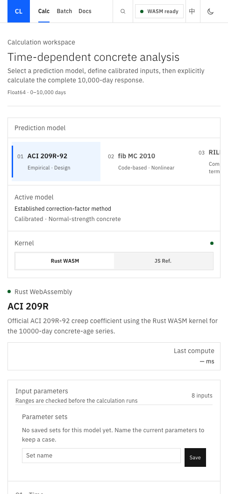 | 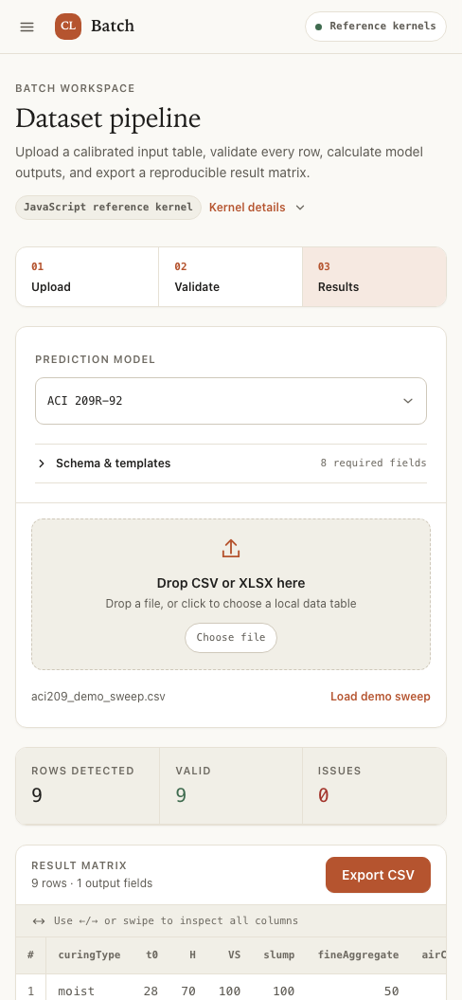 | 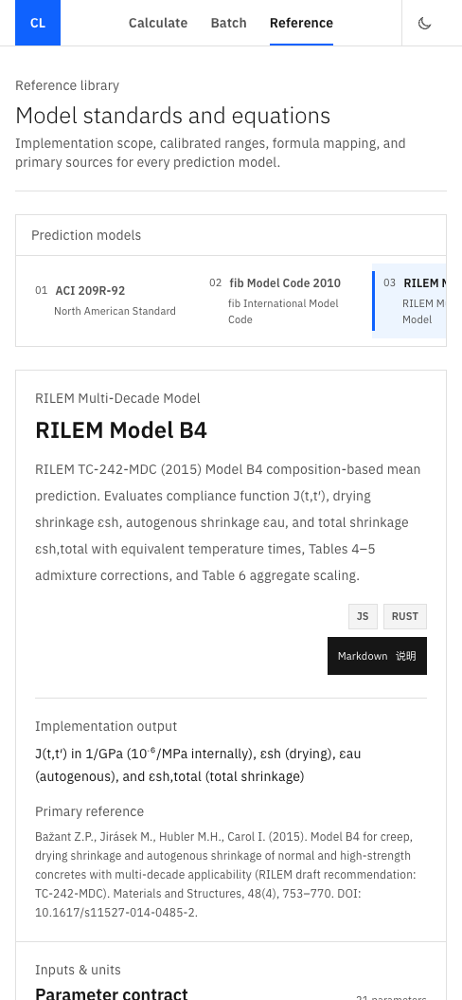 |

### Responsive Verification

The calculation workspace is checked at four viewport widths — mobile, tablet, desktop, and large desktop:

| 390 px | 768 px |
| --- | --- |
| 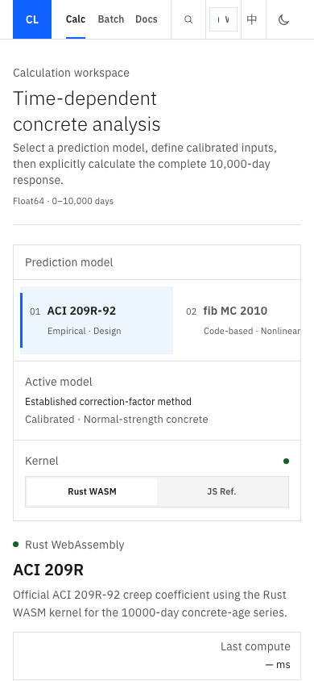 | 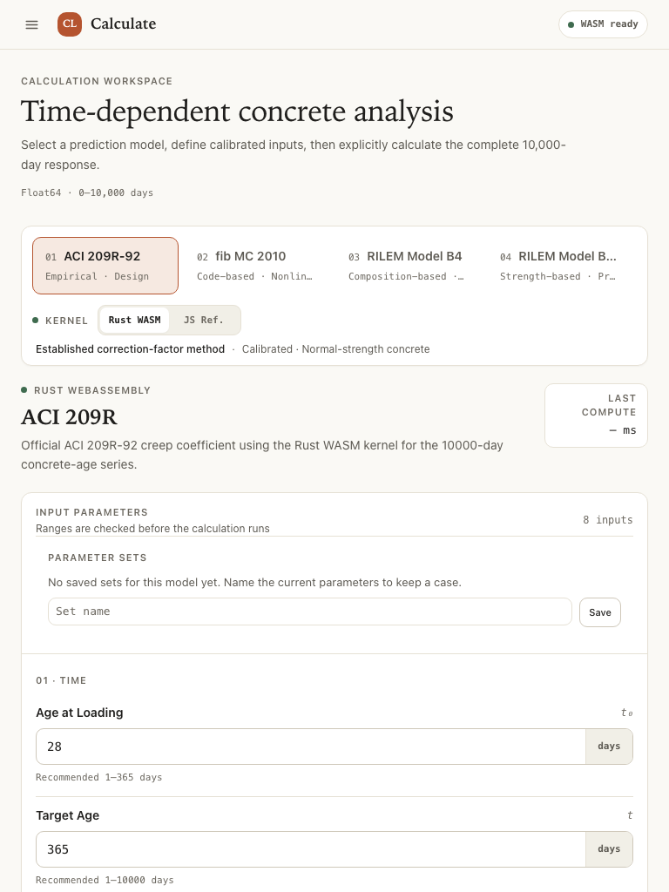 |

| 1440 px | 1920 px |
| --- | --- |
| 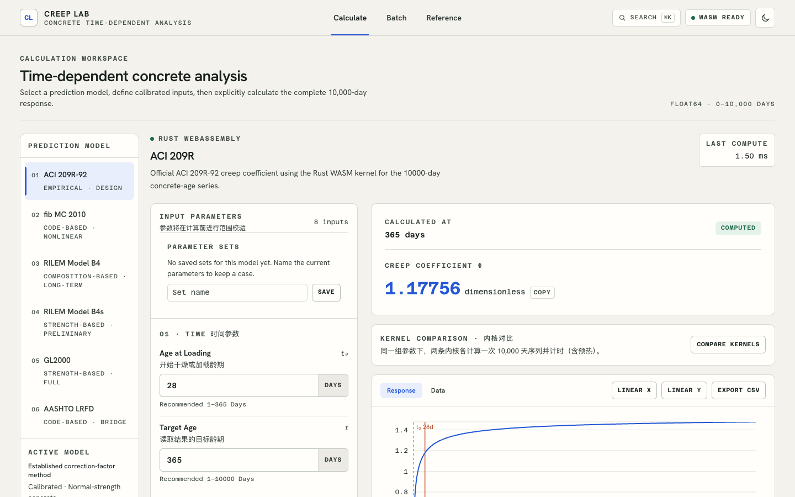 | 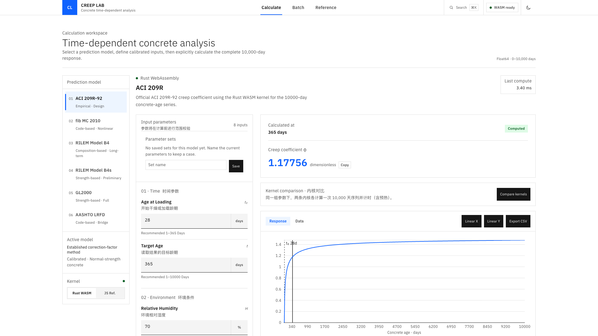 |

---

## Architecture

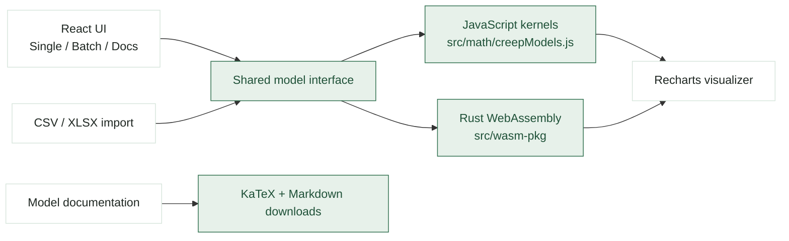

The computation layer is intentionally split: JavaScript kernels provide readable reference implementations, while Rust WebAssembly is the path the Rust engine calculators run. The two are held to numerical agreement by the parity suite, and the calculation workspace can time them against each other on the same inputs.

---

## Supported Models

| Model | Source | Main output |
| --- | --- | --- |
| ACI 209R-92 | American Concrete Institute | Creep coefficient $\phi(t,t_0)$ |
| fib Model Code 2010 | fib European model code | $\phi(t,t_0)=\phi_{bc}+\phi_{dc}$ |
| B4 | Bažant / Northwestern University | Compliance $J(t,t')$ and shrinkage |
| B4S | Simplified B4 variant | Compliance $J(t,t')$ and shrinkage |
| GL2000 | Gardner & Lockman 2001, via ACI 209.2R-08 Appendix A.4 | Compliance $J(t,t')$ and shrinkage |
| AASHTO LRFD | AASHTO LRFD Bridge Design Specifications, Article 5.4.2.3 | Creep coefficient $\psi(t,t_i)$ and shrinkage |

Each model is exposed through both a JavaScript reference implementation and a Rust WebAssembly engine.

---

## Local Development

```bash
git clone https://github.com/halunhaku/creep_cal.git
cd creep_cal
npm install
npm run dev
```

Open:

```text
http://localhost:5173
```

Production build:

```bash
npm run build
npm run preview
```

Run tests:

```bash
npm test
```

Lint:

```bash
npm run lint
npm run lint:fix
```

### Screenshots

Every image in this README is generated from the running app by a script. After changing the interface, rebuild the app and regenerate the images to keep them in sync:

```bash
npm run build
npm run screenshots
```

`scripts/capture-screenshots.mjs` serves `dist/`, drives headless Chrome over the DevTools Protocol, clicks through the three workspaces (loading the demo dataset and running a kernel comparison where that is the point of the shot) and writes `docs/images/`. It needs Chrome; set `CHROME_PATH` if it is not in the usual place.

Two runs over one unchanged build produce byte-identical files, which is what makes a diff of `docs/images/` worth reading. Nothing else needs doing to keep that true: the calculation workspace renders the kernel's own measured runtime, and the script stamps those values out — along with the clock time on each log line — before capturing, the way `dom-snapshot.mjs` normalises the same values before hashing. So the timing readouts in the images below read `— ms` rather than a number nobody could reproduce. If a change to the app's markup moves those readouts out from under the script, the capture fails loudly instead of quietly going back to churning.

### Proving a refactor is invisible

Restyling and reformatting must not change what the app renders, which the screenshots above now cover at their viewports. For the states that are not reachable from a URL — a kernel comparison in flight, the batch pipeline empty and loaded — this hashes the rendered DOM of six states, with the same millisecond values, ratios and clock times normalised away:

```bash
npm run build
node scripts/dom-snapshot.mjs --save     # before the change
# ...make the change, then npm run build...
node scripts/dom-snapshot.mjs --check    # non-zero exit if anything moved
```

Wait on the same `dist/` build on both sides: `vite preview` serves `dist/`, so a forgotten rebuild turns the comparison into a check of the old build against itself.

### Rust WebAssembly

The WASM package is prebuilt in `src/wasm-pkg/`, so the app can run without rebuilding Rust.

When changing Rust source, regenerate the committed package:

```bash
npm run build:wasm        # rust-engine/build.sh, from the repository root
```

The script wraps `wasm-pack build --target web --out-dir src/wasm-pkg
--scope creep-calculator` and restores the curated `src/wasm-pkg/.gitignore`
that `wasm-pack` overwrites with a bare `*`; running `wasm-pack` by hand leaves
that file modified and the CI drift check failing on its own.

`src/wasm-pkg/` is a build artifact that ships with the app, so it must be
regenerated in the same commit as any Rust change — the JavaScript/Rust parity
tests in `src/wasm/kernelParity.test.js` fail if the two drift apart.

CI rebuilds the package with `wasm-pack` **0.13.1**, the version that produced
the committed one, and fails if the rebuild differs — a newer `wasm-pack` writes
`package.json` with a trailing newline this one does not, so bump that pin in
`.github/workflows/ci.yml` and regenerate the package in the same commit.

The build also drops the `producers` section `wasm-bindgen` stamps into the
module (`scripts/stripWasmProducers.mjs`). Its contents name the wasm-bindgen
build — a released binary says `0.2.129 (165586f85)`, a `cargo install`ed one
says `0.2.129` — and nothing reads it at run time, so without the strip the
committed package disagreed with a rebuild done on the other kind of machine.

`rust-engine/Cargo.lock` is committed because the `wasm-bindgen` version in it
must match the CLI that produced the generated JavaScript glue. Without the
lockfile a rebuild can pick a newer `wasm-bindgen` and rewrite the glue.

On Windows:

```bash
cd rust-engine
build.bat
```

---

## Design Language

CREEP_LAB uses the warm editorial language defined in [`docs/design-system.md`](docs/design-system.md), modelled on the Claude web interface: a paper-coloured canvas, a persistent beige navigation rail, soft 12px cards, serif display headings against a system-sans body, monospace engineering values and a single terracotta accent.

| Token | Light (default) | Dark |
| --- | --- | --- |
| Background | Warm paper `#faf9f5` | Charcoal `#262624` |
| Navigation rail | Beige `#f0eee6` | Ink `#1f1e1c` |
| Emphasis | Terracotta `#b5542f` | Terracotta 40 `#e08b6e` |
| Surfaces | White cards, 12px corners, 1px hairlines | Gray 90 / Gray 80, same geometry |
| Type | Serif display (Iowan / Songti) + system sans + system mono; KaTeX equations | Same |
| Interaction | Collapsible sidebar, 48px touch targets, accent focus ring, explicit calculation and keyboard shortcuts | Same |

The sidebar toggle stores both the theme (`theme-mode`) and the rail width (`creep-lab:sidebar`) in `localStorage`. Both themes are covered by the WCAG AA token contrast tests.

---

## Project Map

```text
creep_cal/
  README.md
  eslint.config.mjs
  scripts/
    capture-screenshots.mjs   # regenerates every image below
  docs/
    images/                   # all generated by npm run screenshots
      readme-hero.png
      ui-*.png
      responsive-single-*.png # the four widths documented above
  public/
    模型说明/                 # Chinese model notes, downloadable from the reference library
    模型示例/                 # published sample datasets, downloadable from the batch page
  rust-engine/
    Cargo.toml
    Cargo.lock
    src/
  src/
    components/
      ui/
      batchModels.js          # batch model registry (kept out of the component file)
      ModelCalculator.jsx
      Aci209Calculator.jsx
      Mc2010Calculator.jsx
      B4Calculator.jsx
      B4sCalculator.jsx
      Gl2000Calculator.jsx
      AashtoCalculator.jsx
      BatchCalculator.jsx
      DocsPage.jsx
      SingleCalculationDashboard.jsx
      *.test.jsx            # component-level regression tests
    math/
      creepModels.js        # JavaScript reference kernels, MAX_SERIES_DAYS
      *.test.js             # kernel benchmarks and validation tests
    wasm/
      creepEngine.js        # loader, error normalisation, parameter contracts
    wasm-pkg/
```

---

## License / Status

MIT License.

Current status: local-first calculation workspace with responsive UI checks across mobile, tablet, desktop, and large desktop widths.
